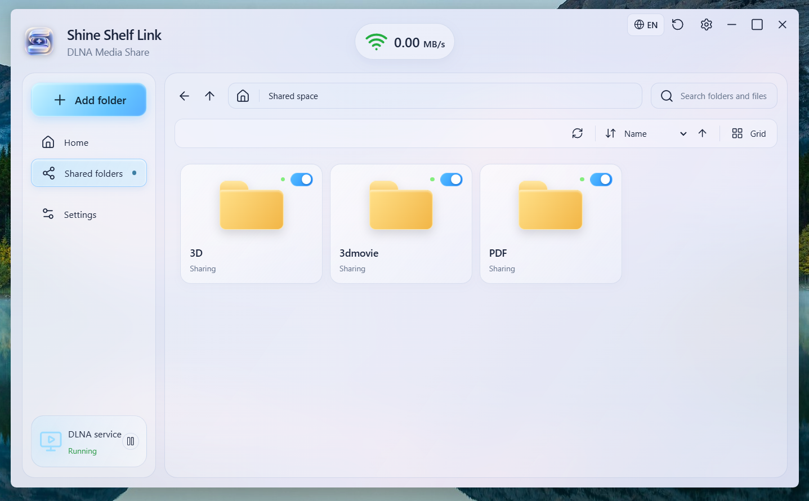

# Shine Shelf Link

**Your media. Your devices. One local network.**

Shine Shelf Link is a companion media-sharing application for **Windows and Android**, designed to make your personal media library easy to access from **Shine Shelf VR Player** and other compatible DLNA/UPnP media players.

Choose the folders you want to share, keep your library organized, and browse videos, photos, comics, and other supported files over your local network—without repeatedly copying everything to your VR headset.

**[简体中文](README.zh-CN.md) · [Technical notes](docs/TECHNICAL_NOTES.md)**



## ✨ Features

### 📁 Share folders in a few clicks
- Add folders from your computer or phone to your shared library.
- Share the contents of selected folders, including accessible subfolders.
- Keep a list of your selected folders for your next session.
- Turn sharing on or off for individual folders.
- Browse your collection with a familiar, file-explorer-style interface.

### 📡 Stream across your local network
- Make your library discoverable to compatible **DLNA/UPnP AV** players.
- View the DLNA server's running status and current transfer activity.
- See relevant network information and diagnose common connection problems.
- Use your existing Wi-Fi or wired LAN—no media upload to an external hosting service is required for local sharing.

### 🎨 Designed to feel at home with Shine Shelf
- A soft, translucent interface inspired by **Shine Shelf VR Player**.
- An alternative clean, light appearance.
- Easy-to-scan folder cards, sharing toggles, and quick access to settings.

### ⚙️ Personalize your server
The settings experience is designed around:
- Your **DLNA device name** (shown to compatible players).
- The computer's **local IP address** and network status.
- Optional **launch at startup** on supported platforms.
- **Appearance** preferences.

*The exact feature set can differ between Windows and Android builds. Check the release notes for your installed version.*

## 🚀 Getting started

1. Download the appropriate **Windows** or **Android** package from the repository's **Releases** section (if a build has been published).
2. Install and open **Shine Shelf Link**.
3. Select **Add Folder / 添加文件夹** and choose the folders you want to make available.
4. Make sure **DLNA Service** is running and the folders you want are enabled for sharing.
5. Connect your Quest and the sharing device to the **same accessible local network**.
6. Open **Shine Shelf VR Player → DLNA**, locate the Shine Shelf Link media server, and browse your library.

You can also try another DLNA-compatible player to check interoperability.

> **Note:** You do not need to upload your media to a cloud service for DLNA playback. The sharing device must remain powered on, network-connected, and able to serve files while you watch.

## 🖥️ Windows & 📱 Android

| | Windows | Android |
|---|---|---|
| Main purpose | Share selected folders from your PC | Share folders accessible on your phone |
| Local network | Wi-Fi or Ethernet | Wi-Fi / supported local network |
| Folder browsing | Explorer-style file navigation | System file/folder selection and browsing |
| Background behavior | Depends on app and startup settings | Subject to Android background-service and battery restrictions |

Package availability and supported Android versions are listed with each release rather than assumed here.

## 📶 Understanding the network indicator

- **`MB/s`** shows current file-transfer throughput (for example, `0.00 MB/s` when nothing is streaming).
- **`Mbps`** may show a Wi-Fi connection's negotiated link rate, **not** a guaranteed streaming speed.
- **Green / yellow / red** should represent actual connectivity and server health, not Wi-Fi signal strength alone. A strong signal cannot guarantee that multicast discovery or HTTP streaming works.

For the underlying networking considerations, see [Technical notes](docs/TECHNICAL_NOTES.md).

## 🧩 How it works

```text
Windows PC / Android phone
        │ Select folders
        ▼
   Shine Shelf Link
   (DLNA MediaServer)
        │ SSDP discovery + media directory
        │ HTTP media streaming
        ▼
Shine Shelf VR Player / other compatible DLNA clients
        │
        ▼
 Browse and play your media over the local network
```

Actual format and codec compatibility depend on both the server and the receiving player. DLNA discovery alone does not mean every file can be decoded by every device.

## 🛠 Troubleshooting

**My VR headset cannot find the server.**

Make sure both devices are on the same reachable LAN; check guest Wi-Fi, AP/client isolation, VPNs, multicast filtering and Windows Firewall. Confirm that DLNA sharing is running. Some routers block SSDP multicast between separate Wi-Fi bands, VLANs, or guest networks.

**I can see folders but a video won't play or seek.**

Check whether the receiving player supports the media container and codecs. For seeking in large files, the server needs to handle HTTP byte-range requests correctly.

**My Android phone stops sharing in the background.**

Android restricts background services and may stop an app because of battery policies. Refer to the Android release notes for the supported background-sharing behavior.

**Why does the app show `0.00 MB/s`?**

This is expected when no client is actively transferring data. It is not a measurement of your Wi-Fi link speed.

## 🔒 Privacy & local-network security

Shine Shelf Link is intended for **trusted local networks**. A DLNA server can be discoverable by other devices on that network, and shared files may be accessible to them. Share only folders you intend to expose; avoid running the service on untrusted/public networks. Do **not** port-forward the service to the public Internet.

## 💬 Feedback

Bug reports, interoperability issues, translation suggestions, and feature requests are welcome through the repository's **Issues** section. When reporting a connection problem, include your platform, router/network setup, target DLNA player, and the steps needed to reproduce it (without posting private IPs or credentials).

---

*Shine Shelf Link is a companion project for Shine Shelf VR Player. Product names and trademarks mentioned here belong to their respective owners. This is not an official Meta product.*
