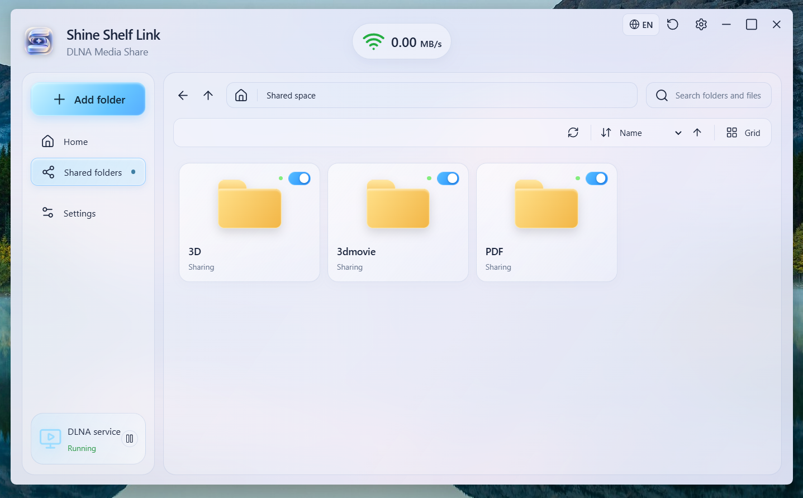

# Shine Shelf Link｜光匣局域网媒体共享

**你的媒体，无需反复传输。**

Shine Shelf Link 是专为 **Shine Shelf VR Player（光匣 VR 播放器）** 打造的 Windows / Android 局域网媒体共享工具。选择电脑或手机中的文件夹，即可通过 **DLNA / UPnP AV** 让同一局域网内的 VR 播放器等兼容设备发现和浏览你的媒体内容。

不必每次都将视频、照片或漫画拷贝进头显。把文件夹交给 Shine Shelf Link，戴上头显便能访问自己的媒体库。

**[English](README.md) · [技术说明](docs/TECHNICAL_NOTES.md)**



## ✨ 主要功能

### 📁 文件夹共享
- 一键**添加文件夹**，将所选目录及可访问的子目录加入共享列表。
- **记住已添加的文件夹**，无需每次重新选择。
- 单独开启或关闭某个文件夹的共享状态。
- 以**资源管理器式导航**浏览文件夹，支持路径导航和搜索操作。

### 📡 局域网播放
- 将软件作为 **DLNA 媒体服务器**，让兼容设备发现和读取媒体列表。
- 显示 DLNA 服务运行状态与当前数据传输速率。
- 利用已有局域网访问媒体，无须为本地共享搭建公网服务器。

### 🎨 与光匣一致的界面
- 延续 **Shine Shelf VR Player** 的通透、柔和、圆角玻璃视觉风格。
- 提供清爽的浅色界面设计。
- 文件夹卡片、共享开关和导航操作直观易用。

### ⚙️ 个性化设置
设置界面围绕 **DLNA 设备名称、本机 IP 地址、开机启动（适用平台）与界面外观** 进行设计。

*Windows 与 Android 版本的功能细节可能有所差异，请以对应版本的更新说明为准。*

## 🚀 使用方法

1. 在 GitHub 项目的 **Releases（发行版）** 页面获取已发布的 Windows 安装包或 Android APK。
2. 安装并打开 **Shine Shelf Link**。
3. 点击左上角 **添加文件夹**，选择需要共享的目录。
4. 确认左下角 **DLNA 服务**显示“正在运行”，并确保目标文件夹已开启共享。
5. 让电脑/手机与 Quest 头显连接到**彼此可访问的同一局域网**。
6. 打开 **Shine Shelf VR Player → DLNA**，选择 Shine Shelf Link，浏览和播放文件。

> 注意：共享设备需要保持开机、联网，并且软件服务处于运行状态；关闭电脑或系统终止手机后台服务后，头显将无法继续读取文件。

## 📶 网络速度与状态说明

- **MB/s**：当前实际文件传输速率。无人访问文件时显示 `0.00 MB/s` 属于正常情况。
- **Mbps**：Wi-Fi 协商链路速率，例如 `1200 Mbps`，不代表真实可用的视频传输带宽。
- **绿色 / 黄色 / 红色**：建议综合检测本机网络、服务监听、局域网发现与文件传输是否正常，不能只凭 Wi-Fi 图标信号强弱判断是否可播放。

## 🧩 技术原理

```text
Windows / Android 设备
       ↓ 选择共享文件夹
   Shine Shelf Link
     DLNA 媒体服务器
       ↓ SSDP 发现 / 媒体目录浏览 / HTTP 传输
   Shine Shelf VR Player
       ↓
    浏览与播放媒体
```

它是**局域网媒体服务器**，不是屏幕镜像投屏工具。能否播放某种视频、ISO、HDR 或漫画文件，还取决于接收端软件本身对文件格式和解码器的支持。

## ❓ 常见问题

**Quest 找不到共享服务器？**

检查是否连接了访客 Wi-Fi、是否开启客户端隔离/AP Isolation、Windows 防火墙是否允许软件通信，以及 VPN / 路由器设置是否阻止 SSDP 组播。不同子网之间也可能无法自动发现。

**能看到视频但无法拖动进度条？**

需要检查播放端的解码支持，以及服务器对 HTTP Range（分段读取）的支持情况。

**手机锁屏后共享中断？**

Android 的后台运行与省电策略可能终止服务。具体后台支持情况以对应 Android 版本为准。

**能共享到任意互联网设备吗？**

默认目标是**可信任的局域网**，不提供公网穿透功能，也不建议将 DLNA 服务端口映射到互联网。

## 🔒 安全说明

局域网内的其他兼容设备可能发现共享服务器，甚至读取你开放的文件。请只分享需要公开给家庭设备的目录，并避免在公共 Wi-Fi 环境中开放私人文件夹。

## 💬 反馈与建议

欢迎通过 GitHub **Issues** 提交 Bug、设备兼容性反馈及功能建议。请附上系统版本、连接方式、播放设备与复现步骤，避免公开个人凭据或敏感网络信息。

---

*Shine Shelf Link 是 Shine Shelf VR Player 的配套项目，并非 Meta 官方产品。*
